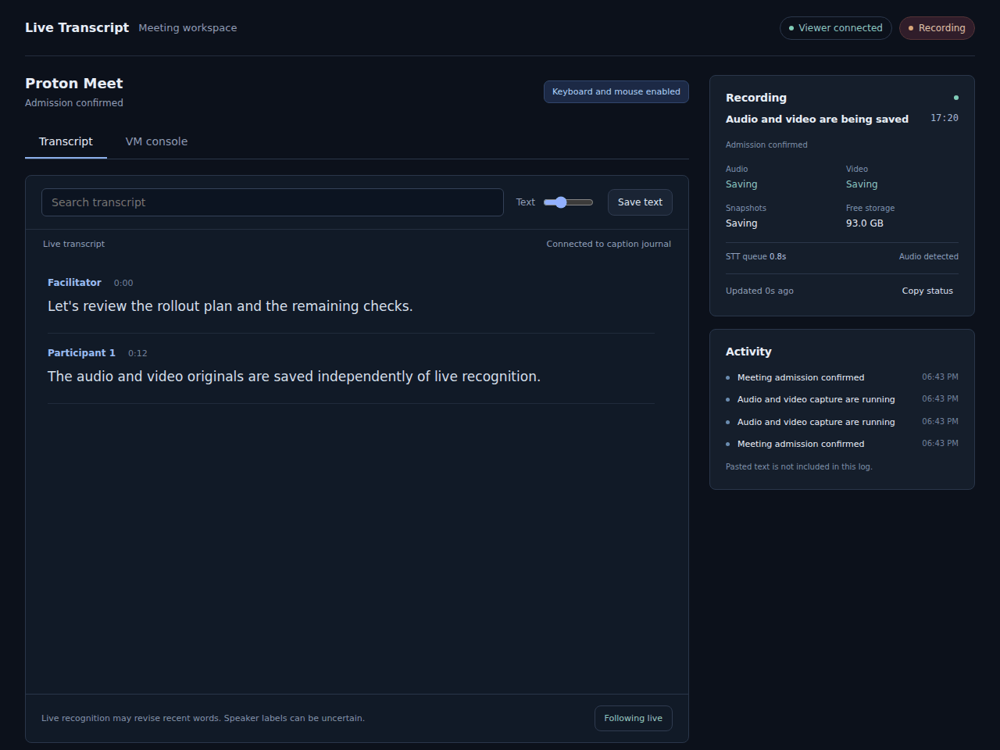

# Live Transcription Bot

A self-hosted meeting recorder with live captions, meeting notes, a caption
camera, and optional text-to-speech. Operate it with **`live-transcript`**.
Zoom and Proton Meet adapters are included; Google Meet support is experimental.



Synthetic demo with fictional participants: captions arrive, the reader searches
the transcript, then switches to the isolated VM console. The workspace shows
recording health separately from recognition, with optional draft meeting notes.
See [the walkthrough](docs/workspace.md) for controls and a Hermes example.

## Quick start with Docker

On an x86-64 Linux host with Docker Engine/Compose and working KVM:

```bash
./deploy.sh init "$HOME/transcript-runtime"
./deploy.sh up "$HOME/transcript-runtime"
./deploy.sh check "$HOME/transcript-runtime"
./deploy.sh workspace "$HOME/transcript-runtime"
```

Run these from a cloned checkout. The wrapper builds the committed application,
handles UID/GID, downloads verified models and provisions the browser VM.
Open the printed private workspace link to join a meeting, view/control its
browser, read captions, or review saved recordings. Allow at least 24 GiB RAM
and local space for models, VM disk and recordings. Initial setup needs internet.
Host Python, FFmpeg, libvirt and Node are unnecessary for this deployment.

`init` creates the deployment; `up` starts it. Keep the deployment directory when
upgrading. After updating the checkout, `./deploy.sh update DIRECTORY` replaces
only application services and leaves the VM running. `rollback` restores a
compatible retained application release. See [installation and updates](docs/application-deployment.md)
and [the workspace guide](docs/workspace.md).

## Choose a deployment

| Starting point | Deployment |
| --- | --- |
| A prepared browser VM is available | [Docker application](docs/application-deployment.md): CLI, UI/backend, retrieval and final recognition in an image, with separate caption/speech services |
| A new VM needs provisioning | [Docker application with KVM](docs/application-deployment.md#provision-the-application-and-browser-vm): Compose provisions the guest and media devices; [native setup](#native-setup) is also available |
| Only caption/speech packaging is needed | [Portable backend](docs/container-backend.md) |

The Docker application host needs Git for the initial source build and Docker
Engine/Compose, plus `/dev/kvm` when provisioning its VM. Python, FFmpeg, speech binaries and host systemd user services
are packaged or replaced inside the deployment. The browser always stays in a VM.

## Native setup

Automatic setup currently supports an x86-64 Linux host with KVM virtualization,
Python 3.11+, an apt-based distribution, sudo access, and a systemd user manager.
Allow at least 16 GiB RAM (24 GiB for GPU plus full CPU standby), local disk space
for the VM/models/recordings, and internet access for the initial downloads.
The browser always runs inside its own VM. Replace `REPOSITORY_URL` below with
the clone URL for this repository.

```bash
git clone REPOSITORY_URL live-transcription-bot
cd live-transcription-bot
./install.sh --plan
./install.sh
source .venv/bin/activate
live-transcript check
live-transcript --json info
```

`install.sh` prepares the Python environment and runs `live-transcript setup`.
For an already installed package, run `live-transcript setup` directly.
`setup` installs missing host tools, creates an owned Ubuntu browser VM, installs
Chromium and its audio/video devices, builds a pinned whisper.cpp revision,
downloads checksum-verified full/small/VAD speech models, and creates the private
profile and services. It tests actual audio capture and caption-camera output
without joining a meeting. The portable default uses CPU recognition; full-model
recognition is preferred and originals are retained if live processing falls behind.

The default profile is `~/.config/live-transcript/config.toml`. Setup refuses to
replace an unrelated profile or VM. If you already have an installation, select
an isolated new profile with `live-transcript --config /path/to/new.toml setup`;
use that same `--config` for subsequent commands. Rerun the same setup command to
resume an interrupted installation. Edited profiles and changed setup plans are
protected from automatic replacement.

Storage defaults to local directories. An additional archive disk or remote
archive destination is optional. No storage server, Hermes account, meeting link,
model weight, recording or credential is included in this repository.

## Deployment choices

- **Docker application:** `live-transcript --config VM_PROFILE deployment OUTPUT ...`
  exports the full application and CPU backend for a prepared VM; add `--managed-vm`
  to provision the guest with a QEMU/KVM sidecar. It includes a
  durable job supervisor and final recognition tools; host apt/Python/systemd are
  unnecessary at runtime. The [Docker-only bootstrap](docs/application-deployment.md#build-without-installing-python-on-the-host)
  also avoids installing Python to prepare it.
- **Default:** managed browser VM; native host speech services supervised by systemd.
- **Compose speech:** `live-transcript setup --speech-supervisor compose` runs CPU
  speech services in Docker Compose. Browser, camera and original capture stay in
  the VM; the controller/caption service remain on the host.
- **Portable backend:** `live-transcript backend OUTPUT --models MODEL_DIR --state STATE_DIR`
  exports a Compose caption-and-CPU-speech stack. That backend needs Docker rather
  than host apt packages or systemd. VM provisioning, controller and final
  processing remain separate; see [container backend setup](docs/container-backend.md).
- **Existing infrastructure:** configure a prepared VM and existing speech endpoints
  using [config.example.toml](config.example.toml) and [deployment](docs/deployment.md).
  Empty names under `[services]` disable local service management for externally
  supervised endpoints.

Use `setup --help` for VM resources, local disk location, backend, installation
workspace, and preparation without starting services. CUDA/HIP builds require
an already working vendor driver/toolchain; CPU setup needs no GPU software.
Summaries use an optional OpenAI-compatible endpoint configured under `[model]`.
TTS is optional and its voice assets are described in [deployment](docs/deployment.md#optional-tts).

See [deployment architecture](docs/deployment-architecture.md) for supervision,
container, recovery, storage, and deployment tradeoffs.

## View and control the VM

Open the browser console while a meeting is starting or running:

```bash
live-transcript --json console
# Enable keyboard/mouse, direct paste, and pause automated UI recovery:
live-transcript --json console --control
# Reach it from your VPN. Use your host's actual VPN address or hostname:
live-transcript --json console --control --listen 0.0.0.0 \
  --advertise-host console.example --port 6080 --max-min 90
```

Open the printed private URL. It includes the authentication token and VNC
password in its fragment. Keep that full link private. The workspace opens with
searchable live captions, speaker labels, adjustable text size, follow-live and
text export. Optional draft notes appear below the transcript. The **VM console**
tab has the scaled viewer, one-step paste, keyboard shortcuts and reconnect.
For an always-available page with meeting controls and a recording library, use
`live-transcript workspace` or the Docker workspace service.
Recording health, storage, speech status and activity remain visible beside it.
**Listen** plays the selected VM’s meeting audio through your browser without
enabling your microphone. Playback and recording have independent lifetimes.
Select the destination field in the VM, then paste into the side panel; it never
sends an Enter key. Node is needed only when rebuilding the UI, not to run it.

For one login across VM consoles, set `[console] login_mode = "shared"` and the
same `shared_login_file` in their host profiles. After logging in once, other
consoles on that hostname open without another token or VNC password. The
default `isolated` mode keeps separate logins. See
[console authentication](docs/operator-console.md#access-and-deployment).

The listener defaults to loopback. Explicit external binding is intended for a
trusted VPN; use a TLS reverse proxy for an untrusted network. Leave the console
command running, or supervise it independently. Closing the viewer does not stop
an ordinary meeting's capture. Manual control expires when its SSH heartbeat is
lost; automation then resumes. Multiple active VM displays require `--display :N`.

`console --idle --control` opens a separate diagnostic browser when the VM is
idle. That desktop has its own bounded service and survives a viewer disconnect;
it holds the VM's idle lease until its lifetime ends. It does **not** automatically
record a manually joined call. Use `start` for supervised admission and recording.

See [console operations](docs/operator-console.md) and the
[Hermes integration contract](docs/hermes.md) for recovery, notifications, and
sharing the console link before a meeting.

For concurrent recordings, provision a separate VM/profile for each meeting.
Use [the console hub](docs/multiple-meetings.md#one-ui-for-several-vms) to switch
between several VMs in one page, with one login and the selected VM's controls.
See [multiple meetings](docs/multiple-meetings.md) for isolation and shared
speech-service capacity.

## Join and record a meeting

Use the full invitation and keep it quoted:

```bash
live-transcript start 'https://zoom.us/j/MEETING_ID?pwd=PASSWORD' --max-min 90
# Or:
live-transcript start 'https://meet.proton.me/join/id-ROOM#pwd-SECRET' --max-min 90
# Or (experimental):
live-transcript start 'https://meet.google.com/abc-abcd-efg' --max-min 90
```

For a separately supplied Zoom passcode:

```bash
live-transcript start 'https://zoom.us/j/MEETING_ID' --passcode 'PASSCODE'
```

Google Meet uses a headed browser controlled through loopback CDP, with a fresh
private context by default. Guest access still depends on the host and Workspace
policy. Automatic guest admission remains experimental. Set `google.manual_join=true`
to join through the [operator console](docs/deployment.md#google-meet-browser);
the bot detects admission and starts captions automatically.

The command deploys the current guest bundle automatically, joins the meeting,
and follows its log. If the room has a waiting room, the host must admit the bot.
Live captions and the convenience WAV start after confirmed admission. Google also
keeps an independent audio/video archive of the join and recovery sequence before
admission. The display name comes from
`identity.name`; override it with `--name 'Meeting Transcript'` if needed.

A Proton invitation's `#pwd-...` fragment is required. Keep real invitations and
passcodes out of shared terminal logs and shell history.

## Check progress and stop

In another terminal with the same profile:

```bash
live-transcript status
live-transcript stop
live-transcript jobs
```

`stop` asks the owned meeting session to close cleanly. After the meeting ends,
retrieval, final transcription, summary and video generation continue in a
background job. `jobs` shows their recent status and checkpoint locations.
Use `live-transcript --json status` or `live-transcript --json jobs` for automation.

Losing the SSH/log connection does not itself stop the detached guest recorder.
Use `stop` when you intend to leave the meeting.

## Find the recording and notes

Look in your configured `paths.recordings` directory. The example profile uses
`~/.local/share/live-transcript/recordings`. A session produces:

| File | Contents |
| --- | --- |
| `SESSION.archive/` | Original lossless audio segments, screen video, snapshots, speaker evidence and checksums |
| `SESSION.wav` | Reconstructed audio for final transcription |
| `SESSION.txt` | Final timestamped transcript |
| `SESSION.md` | English meeting notes and the full transcript |
| `SESSION.srt` | Subtitles |
| `SESSION.mkv`, `SESSION-burned.mp4` | Derived video, when screen capture is available |
| `SESSION.live.json` | Independent live-caption evidence and saved decoder state |

If `paths.vault` is configured, notes are also copied into its `meetings/` folder.
Processing is not finished merely because the bot has left; check `jobs`.

Verify an archive or process a retained WAV independently:

```bash
live-transcript verify /path/to/SESSION.archive
live-transcript process /path/to/SESSION.wav
```

`process` expects 16 kHz mono PCM16 WAV. It retains the input and previous outputs
on recognition failure. For a failed VM retrieval, use the job's original token
and guest WAV path:

```bash
live-transcript recover RUN_TOKEN /home/transcript/rec/SESSION.wav
```

## Optional speech and Hermes

To speak explicitly into the active meeting:

```bash
live-transcript say --lang en 'The recording is running.'
```

TTS requires `paths.tts` to point to your private Piper installation and voice
assets; see [deployment](docs/deployment.md#optional-tts). Speech is never enabled
merely by starting a transcription session.

Hermes uses these same CLI commands. Start with the reusable
[Hermes skill template](examples/hermes/SKILL.md), then configure its private copy to call
`live-transcript start`, `status`, `stop` and `jobs`, and schedule
`live-transcript watchdog` / `live-transcript calendar` if desired. The core
application has no Hermes SDK dependency. Calendar integration requires a private
ICS URL file and the correct `calendar.timezone`.

`live-transcript --json info` identifies the actual package and selected profile;
check it from the agent's executable rather than assuming every command on PATH
uses the same installation. `--json watchdog --dry-run` inspects decisions without
repairs or state writes. The watchdog retains pending alerts durably; clients can
read them with `--json notifications` and acknowledge delivered IDs explicitly.
See [the delivery contract](docs/hermes.md#durable-notifications-and-delivery).

## Troubleshooting

| Symptom | First check |
| --- | --- |
| Bot stays in lobby | Host admission and the invitation; prejoin is not proof of entry |
| No live captions | `check`, caption/ASR services and VM-to-host connectivity; check that original capture continues |
| Bot has left but notes are missing | `jobs` and its checkpoint; final processing is asynchronous |
| GPU fails | CPU standby health and queued audio; preserve originals for full-model reprocessing |
| Speaker labels look wrong | Treat UI-derived names as uncertain, especially at speaker changes or overlap |
| Archive storage is unavailable | Local safety-copy status and retained VM originals; do not delete evidence |

See [operations and recovery](docs/operations.md) for failure handling. The caption
TCP protocol assumes a trusted network. Overlapping voices, poor audio and
provider UI changes remain limitations; automated tests do not establish word
accuracy or future meeting admission.

## Development and source layout

```text
src/live_transcript/   application package and internal process dispatcher
  runtime/launch.sh    packaged host orchestration
  providers/           meeting-platform browser adapters
  capture/             independent recording
  transcription/       live/final ASR and caption journal
  storage/             retrieval, mirroring and recovery
  notes/               meeting summaries
  presentation/        caption camera and video outputs
  speech/              explicit TTS
  core/                configuration and shared file operations
  integrations/        calendar scheduling
tests/                offline regression tests
tools/                explicit development/test tools
deploy/systemd/       service templates
```

The deployment wrapper manages Docker installations; meeting commands use the
installed CLI. The VM receives one self-contained
`live-transcript.pyz` program, with external browser/media dependencies supplied
by the prepared VM. Normal installed wheels can build this bundle too.

```bash
.venv/bin/pip install -e '.[dev]'
.venv/bin/python -m tools.run_tests
.venv/bin/ruff check src tools tests build_backend.py
.venv/bin/ruff format --check src tools tests build_backend.py
.venv/bin/python -m tools.check_public_source
```
