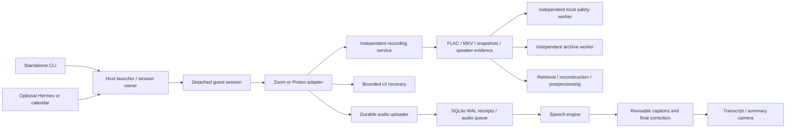

# Architecture

The system separates control, capture, inference, presentation and recovery.
Failure of a convenience feature must not terminate healthy evidence capture.

## Package boundaries

Maintained implementation modules live under `src/live_transcript/`; root Python
files are bootstrap entrypoints. See [the module map](module-map.json) for exact
locations. Subpackages separate capture, transcription, evidence storage,
providers, presentation, explicit speech and optional integrations. Shared
configuration/options live in `core`; lifecycle and orchestration live in
`runtime`. Imports between implementations use qualified package names.

Guest deployment sends the same source package plus bootstrap entrypoints in an
explicit bundle. The guest `join_meeting.py` entrypoint selects the Zoom adapter;
the host entrypoint selects the supervised launcher. Capturing child processes
uses these stable bootstraps rather than executing package files with an
incorrect Python import path. Browser/audio operator modules and postprocessing
perform their operations only from explicit `main()` entrypoints.

## Module boundaries

| Responsibility | Owner | Contract |
| --- | --- | --- |
| Deployment settings | `runtime_config.py` | Validated TOML; explicit known keys; guest export excludes host-only settings |
| Human/automation interface | `live_transcript/cli.py` | Start, status, doctor, stop, say, verify, recover, watchdog |
| Host launch | `scribe_run.sh`, `run_state.py` | One launch lock; private arguments; original deadline; owner-checked updates |
| Guest lifecycle | `meeting_session.py`, `vm_prepare.py` | Lifetime lease; detached systemd process; token-scoped stop/reconnect |
| Provider interaction | `join_meeting_vm.py`, `proton_meet.py` | Validate invitation; prove admission; retain capture during optional feature failure |
| Evidence capture | `recording_guard.py`, `browser_evidence.py` | Independent processes; unique generations; durable events and final hashes |
| Replication | `archive_mirror.py` | Independent NAS and local lanes; checksum copy; never source deletion |
| Captions | `caption_stream.py`, `caption_store.py`, `caption_runtime.py`, `captiond.py` | Durable receipt before ACK; one decoder per session; retry without discarding audio |
| Explicit speech | `browser_voice.py`, `voice_controller.py`, `voice_control.py` | Session-scoped, expiring, at-most-once requests; preserve mute state |
| Presentation | `caption_render.py`, `meeting_board.py` | 4:3 camera; crop-safe captions; evidence-grounded summary hints |
| Retrieval | `pull_recording.py`, `recover_recording.py`, `recovery_worker.py` | Verify inventory; preserve originals; report gaps; checkpoint stages |
| Supervision | `meeting_watchdog.py` | Unknown is not dead; bounded restart; preserve deadline; no global process kills |
| Admission diagnostics | `admission_diagnostics.py` | Precise terminal reasons; scoped evidence; persisted test join limits |
| UI recovery | `ui_rescue.py` | Trusted provider frames; visible approved controls; stale-plan rejection; bounded actions |

## Lifecycle

A host launch is active or control-lost until its exact guest session is known to
finish. A guest can be missing, running, finished, or failed. Archive, captions,
backup, UI and postprocessing each have their own state. A single green process
status does not imply that all of these are healthy.

The host run token identifies ownership. The guest recording/session ID identifies
media. Do not interchange them. Reconnect follows the original guest token and
checks invocation identity. Restart uses the same invitation and remaining
original time budget, with a new recording session and an explicit gap.

Capture uses systemd services separate from SSH and adapters. Clean shutdown sends
one graceful signal to the owner, lets it drain/close children, and only then
permits forced process-group cleanup. Never use interpreter-wide `pkill`, global
Xvfb cleanup, or shared scratch files to identify a particular recording.

## Evidence and clocks

Audio is archival before it is useful transcription. Recording is not gated on
VAD, captions, model availability, speaker detection, summaries, camera health or
backup success. Media generations never overwrite earlier evidence. Wall-clock
UTC and session-relative offsets are recorded; small FFmpeg startup/timestamp
uncertainties remain and should not be described as sample-accurate alignment.

Finalization writes inventory hashes before the completion marker. Mutable WAV
headers require checksum copies, not append-only replication. A source is retained
even after verified retrieval; deletion is an operator retention decision.

## Maintaining provider adapters

The Zoom adapter still contains legacy procedural join/chat/camera logic. This
release adds common configuration, lifecycle, evidence and recovery boundaries;
it does not claim that every provider concern has been rewritten. Future work
should extract a typed provider interface with join, observe, media control and
leave operations, keeping UI data outside the recorder's failure domain.

Do not replace the working provider path until a candidate passes the same real
room, speaker-switch, overlap, mute-state and capture-preservation tests. Native
participant-track capture through an approved SDK is a longer-term alternative
to DOM-derived speaker identity and a mixed audio sink.
