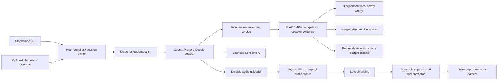

# Architecture

The system separates control, capture, inference, presentation and recovery.
Failure of a convenience feature must not terminate healthy evidence capture.

## Package boundaries

The application lives under `src/live_transcript/`. Subpackages separate capture,
transcription, storage, provider interaction, presentation, speech and optional
integrations. Shared configuration and file operations live in `core`; lifecycle
and orchestration live in `runtime`. There are no root-level runtime aliases.

Operators and Hermes use `live-transcript`. Local supervised child processes use
one internal dispatcher, `python -m live_transcript.worker ROLE`. Guest deployment
builds the same package into `live-transcript.pyz`; its role dispatcher launches
children from that bundle. This avoids separate copies of launcher scripts and
works from an installed wheel. The guest still needs external browser/media
dependencies. Test-only fixtures are included only in an explicitly requested,
separate development bundle.

The substantive host shell workflow is packaged as `runtime/launch.sh`. It owns
SSH orchestration and detached backup/retrieval jobs; Python owns configuration,
state transitions and guest lifecycle. Browser/audio operator modules and final
processing perform work only from explicit entrypoints.

## Module boundaries

Paths below are relative to `src/live_transcript/`.

| Responsibility | Owner | Contract |
| --- | --- | --- |
| Settings | `core/config.py` | Validated TOML; guest export excludes host-only settings |
| Operator interface | `cli.py` | Start/status/stop, services, jobs, recovery and integrations |
| Process dispatch/deployment | `worker.py`, `runtime/deployment.py` | One role registry; reviewed reproducible guest bundle |
| Host launch | `runtime/launch.sh`, `runtime/state.py` | One launch lock; private arguments; original deadline; owner-checked updates |
| Guest lifecycle | `runtime/session.py`, `runtime/prepare.py` | Lifetime lease; detached process; token-scoped stop/reconnect |
| Provider interaction | `providers/` | Validate invitation; prove admission; preserve capture during optional failures |
| Evidence capture | `capture/guard.py`, `capture/observer.py` | Independent writers; unique generations; durable events and hashes |
| Replication | `storage/mirror.py` | Independent archive/local lanes; checksum copies; no source deletion |
| Captions and ASR | `transcription/` | Durable receipt before ACK; one decoder per session; retained audio on failure |
| Explicit speech | `speech/` | Session-scoped, expiring, at-most-once requests; preserve mute state |
| Presentation | `presentation/`, `notes/board.py` | 4:3 camera; crop-safe captions; evidence-grounded summary hints |
| Retrieval/processing | `storage/pull.py`, `storage/worker.py`, `runtime/postprocess.py` | Verify inventory; retain originals; report gaps; checkpoint stages |
| Supervision | `runtime/watchdog.py` | Unknown is not dead; bounded restart; preserve deadline |
| Admission/UI rescue | `providers/admission.py`, `providers/rescue.py` | Scoped evidence; trusted controls; stale-plan rejection; bounded actions |

## Lifecycle

A host launch is active or control-lost until its exact guest session is known to
finish. A guest can be missing, running, finished, or failed. Archive, captions,
backup, UI and postprocessing each have their own state. A single green process
status does not imply that all of these are healthy.

The host run token identifies ownership. The guest recording/session ID identifies
media. Do not interchange them. Reconnect follows the original guest token and
checks invocation identity. Restart uses the same invitation and remaining
original time budget, with a new recording session and an explicit gap.

Capture uses systemd services separate from SSH and adapters. Clean shutdown sends
one graceful signal to the owner, lets it drain/close children, and only then
permits forced process-group cleanup. Never use interpreter-wide `pkill`, global
Xvfb cleanup, or shared scratch files to identify a particular recording.

## Evidence and clocks

Audio is archival before it is useful transcription. Recording is not gated on
VAD, captions, model availability, speaker detection, summaries, camera health or
backup success. Media generations never overwrite earlier evidence. Wall-clock
UTC and session-relative offsets are recorded; small FFmpeg startup/timestamp
uncertainties remain and should not be described as sample-accurate alignment.

Finalization writes inventory hashes before the completion marker. Mutable WAV
headers require checksum copies, not append-only replication. A source is retained
even after verified retrieval; deletion is an operator retention decision.

## Maintaining provider adapters

The Zoom adapter still contains legacy procedural join/chat/camera logic. This
release adds common configuration, lifecycle, evidence and recovery boundaries;
it does not claim that every provider concern has been rewritten. Future work
should extract a typed provider interface with join, observe, media control and
leave operations, keeping UI data outside the recorder's failure domain.

Do not replace the working provider path until a candidate passes the same real
room, speaker-switch, overlap, mute-state and capture-preservation tests. Native
participant-track capture through an approved SDK is a longer-term alternative
to DOM-derived speaker identity and a mixed audio sink.
